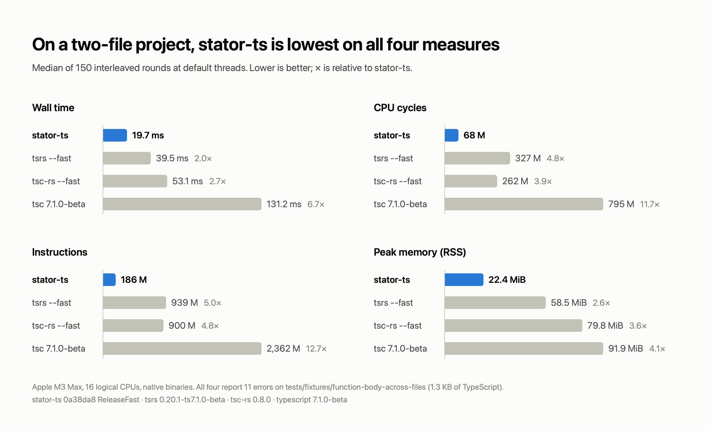
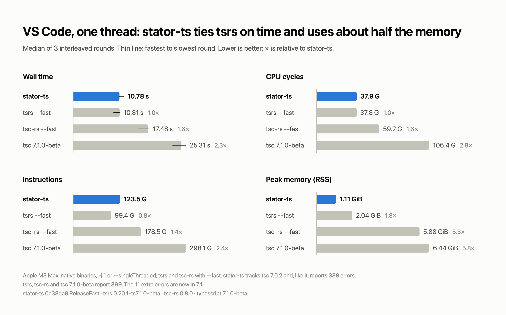

# stator-ts

A TypeScript compiler written in Zig.

```bash
stator-ts check            # type-check the project
stator-ts build            # type-check and emit JavaScript
stator-ts scan             # parse the whole project in parallel, print stats
stator-ts test             # compile and run *.test.ts files in parallel on Node or Bun
```

Build with Zig 0.17.0: `zig build -Doptimize=ReleaseFast`.

On macOS, `scripts/pgo.sh` builds `zig-out/bin/stator-ts-pgo` with profile-guided optimization, which needs clang and a project to train on. On VS Code it runs 26% fewer instructions and takes 16-19% less time at `-j 16`, with the same output.

Train on a representative project, then use the generated binary for subsequent checks or builds:

```bash
mise exec conda:clang@23.1.4 conda:llvm-tools@23.1.4 -- \
  bash scripts/pgo.sh -p /path/to/project --lib-dir /path/to/typescript/lib -j 16
zig-out/bin/stator-ts-pgo build -p /path/to/project --lib-dir /path/to/typescript/lib -j 16
```

The PGO binary is optimized for the build machine. Training is a one-time build step, repeated when rebuilding after source changes; it is not part of each project compilation. Reproducible instruction-count comparisons on the existing test projects are recorded in [the T19 report](plan/T19/instructions-report.md).

`--all-diagnostics` also shows semantic errors when the project has syntax errors, which the default, like the tsc command line, holds back.

## Performance

Native binaries on an Apple M3 Max: stator-ts `0a38da8` built with ReleaseFast and no PGO, tsrs 0.20.1-ts7.1.0-beta, tsc-rs 0.8.0, typescript 7.1.0-beta. Each round runs all four in a rotating order, so load drift falls on them alike.

### Two-file project



`tests/fixtures/function-body-across-files` at default threads, medians of 150 rounds:

| Compiler | Wall | Cycles | Instructions | Peak RSS |
| --- | --- | --- | --- | --- |
| stator-ts | 19.7 ms | 68 M | 186 M | 22.4 MiB |
| tsrs `--fast` | 39.5 ms | 327 M | 939 M | 58.5 MiB |
| tsc-rs `--fast` | 53.1 ms | 262 M | 900 M | 79.8 MiB |
| tsc 7.1.0-beta | 131.2 ms | 795 M | 2,362 M | 91.9 MiB |

All four report 11 errors.

### VS Code, one thread



VS Code `c198526d`, `src/tsconfig.json`, with `-j 1` or `--singleThreaded`, medians of 3 rounds; wall time also gives the fastest and slowest round:

| Compiler | Wall | Cycles | Instructions | Peak RSS |
| --- | --- | --- | --- | --- |
| stator-ts | 10.78 s (10.64–11.82) | 37.9 G | 123.5 G | 1.11 GiB |
| tsrs `--fast` | 10.81 s (9.44–10.89) | 37.8 G | 99.4 G | 2.04 GiB |
| tsc-rs `--fast` | 17.48 s (15.28–17.72) | 59.2 G | 178.5 G | 5.88 GiB |
| tsc 7.1.0-beta | 25.31 s (23.26–26.40) | 106.4 G | 298.1 G | 6.44 GiB |

stator-ts reports 388 errors, the same as tsc 7.0.2, which it tracks. The other three report 399: TypeScript 7.1 adds 11.

## Tests

```bash
zig build test                      # unit tests
bash tests/differential.sh          # fixtures against the real tsc
bash tests/ts7/sync.sh              # fetch TypeScript 7's tests at the pinned commit
bash tests/ts7/sync.sh main         # move the pin to a newer commit
node tests/ts7/run.mjs              # run them, fail if a passing test stopped passing
node tests/ts7/run.mjs --update-passing   # record newly passing tests
```

`run.mjs` also takes `--filter <regex>`, `--limit <n>`, `--jobs <n>`, `--verbose` and `--keep`, and `STATOR_TS` picks the binary. Results land in the ignored `tests/ts7/results/`.

